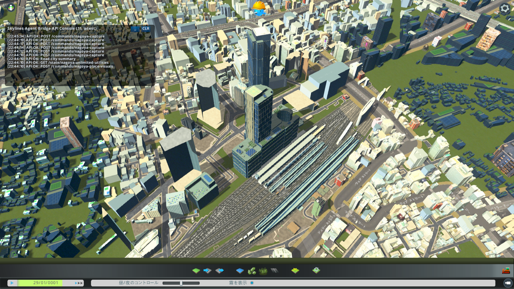
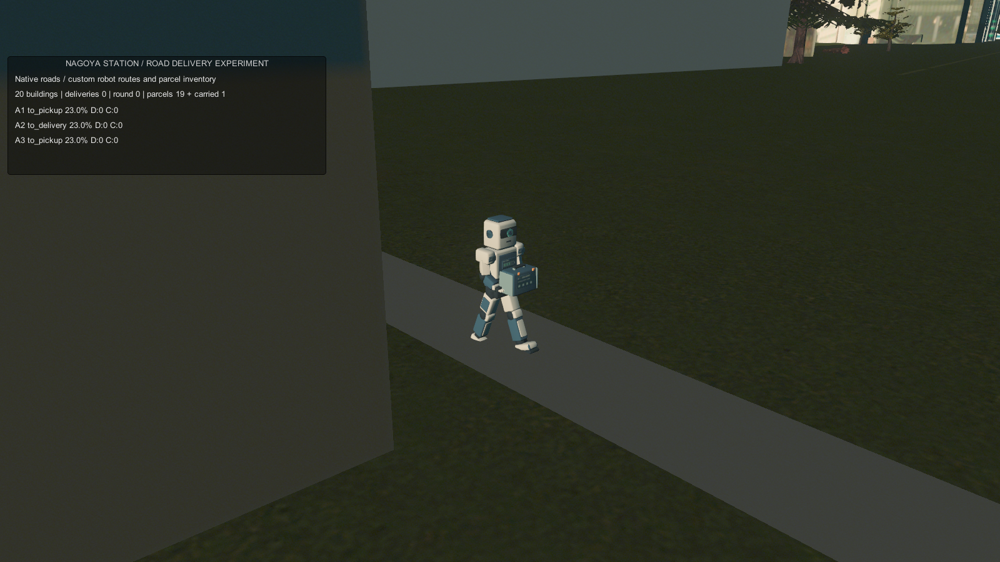
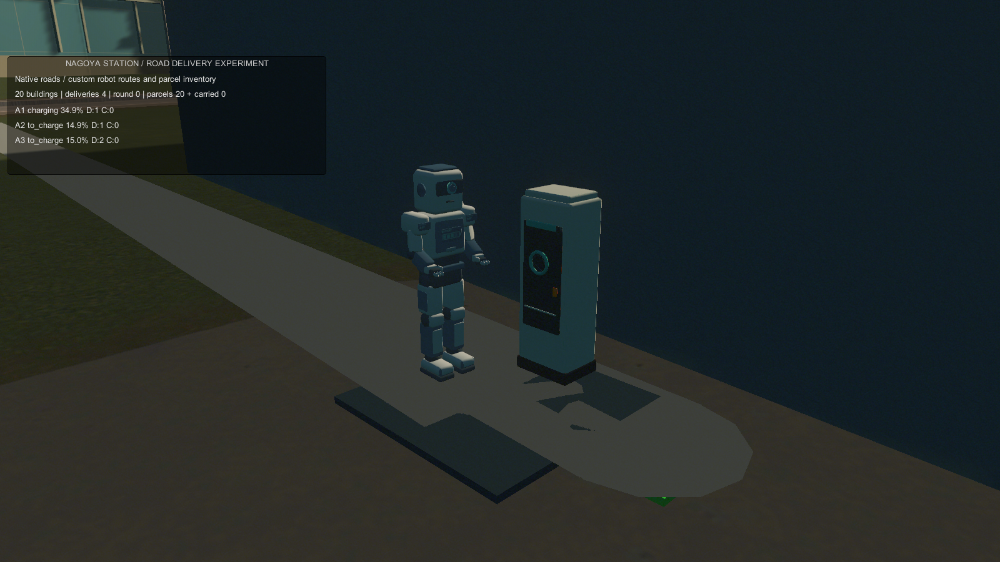
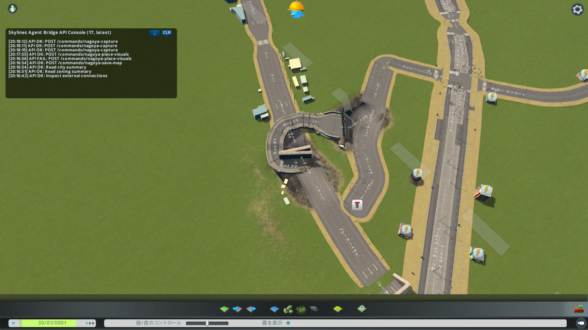
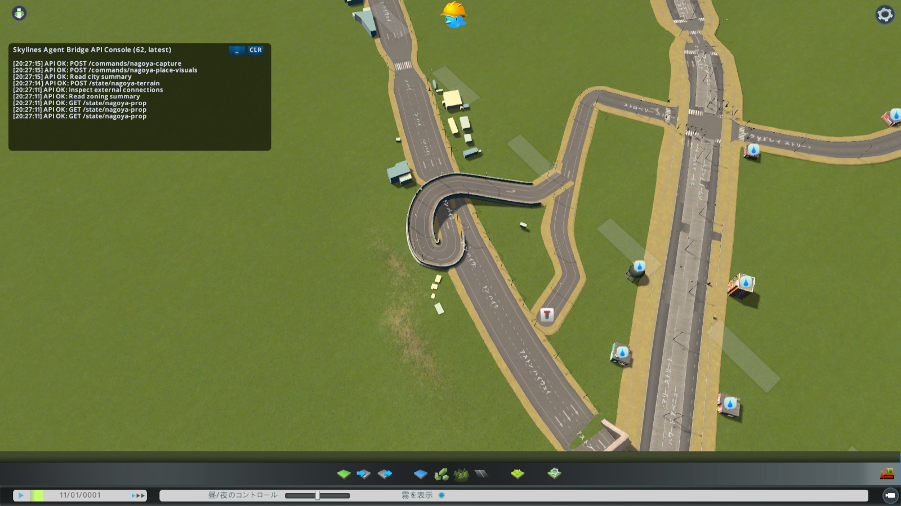
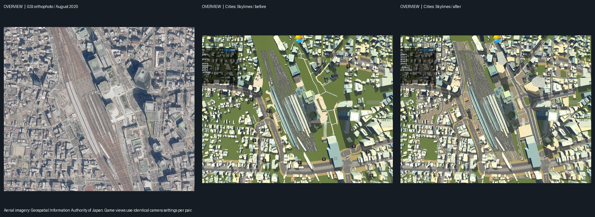

# Android Skyline — 名古屋2050

[English](README.md) | 日本語

Cities: Skylines（初代）で、アンドロイド住民・配送・充電・ゾーニング・ゲーム本体の都市経済が同じ名古屋規模の試験都市でどう共存するかを調べる実験用MODです。C#ソース、オフライン検査、過去の実行を記録した文書を収録しています。

これは研究用のソースリポジトリであり、ワンクリックで導入できるマップパックではありません。必要なゲーム内セーブ、名古屋の外部データ、PLATEAU/OSM由来データ、メッシュ、実行時アセットの一部は同梱していません。任意の実地形Bridgeソースが含まれる場合もありますが、マップ作成に使う外部データや他のローダーは別途必要です。

## 🖼️ 開発をスクショで見る

<a href="docs/images/ee713d36c24d5c3fbcb6a4ce.png"></a>

*実地形版の名古屋駅前。2026年11月20日の実機記録です。*

[**80枚の開発ギャラリー**](docs/gallery.md)では、16区の街並み、Blenderで加工した10棟、道路修正、駅前8街区の整備前後を原画像で追えます。

| 初期実験：配送 | 初期実験：充電 |
| --- | --- |
| <a href="docs/images/8eec27c6ccd82a3d77967fe2.png"></a> | <a href="docs/images/1c2f841f666ebe544bde4c31.png"></a> |

| 道路修正前 | 道路修正後 |
| --- | --- |
| <a href="docs/images/e949bc9f8ecf30e35955b76f.png"></a> | <a href="docs/images/490141b72fde292674399732.png"></a> |

<a href="docs/images/416b68f8d50d971bc928321c.jpg"></a>

*左から国土地理院の2020年8月の航空写真、整備前、整備後。生活実験と実地形版は別の段階です。*

## 🧭 最初に読むページ

- [ドキュメントの入口](docs/index.md)
- [導入と実行](docs/getting-started.md) — 前提、ビルド、オフライン試験、実機検査
- [アーキテクチャ](docs/architecture.md) — CS1本体の仕組みとMOD独自シミュレーションの境界
- [データとライセンス](docs/data-and-licenses.md) — 同梱物、外部データ、出典と権利
- [トラブルシューティング](docs/troubleshooting.md)
- [コントリビューション](CONTRIBUTING.md)
- [セキュリティポリシー](SECURITY.md)

過去の名古屋実験の詳細は、証拠記録として次のページに残しています。

- [CS1都市経済との接続](docs/native-economy.md)
- [アンドロイドの生活・雇用試験](docs/android-life.md)
- [全域ゾーニングとネイティブ建設](docs/citywide-zoning.md)
- [全域建設の技術メモ](docs/native-city-construction.md)
- [実地形の道路・建物QA](docs/real-terrain-road-building-qa.md)
- [任意の実地形ソース](docs/real-terrain-source.md)
- [名古屋駅の航空写真比較](docs/nagoya-station-aerial-comparison.md)
- [名古屋駅の区画別記録](docs/nagoya-station-block-by-block.md)

## 🧪 このリポジトリの実装範囲

現在のコードには、関係はあるものの分けて読むべき三つの経路があります。

1. **CS1本体の建設・経済接続。** 都市名が `NagoyaCitywide-` で始まる場合、`NativeCity*` コンポーネントがCS1本体の道路、ゾーン、建物、住民、職場、インフラ、セーブ台帳を扱います。PLATEAU IDは配置・監査の元IDとして使いますが、元のメッシュ自体が本体の経済建物になるわけではありません。
2. **MOD独自の経路・都市実験。** `CitywideScene` と `CitywideSimulation` は外部の経路グラフを読み込み、アンドロイド、人、道路、区画、充電器を描画します。アクターと荷物のルールはMOD側が持つため、CS1本体の住民経路探索や需要と同じものではありません。
3. **小規模なWaypointデモと地区試験。** `AndroidDemo` は配送・充電を行う単純なゲーム内Waypointループです。出力にも本体住民の経路探索ではないことを記録します。地区コントローラと過去の生活試験も、各経路が本体実装であることの証明ではありません。

同じマップや画面に表示されたからといって、MOD独自のアクターが本体住民の経路を使ったこと、PLATEAUメッシュが本体の区画になったこと、アンドロイド配送が本体需要を変えたことにはなりません。

## 📏 リポジトリの事実

この文書が対象とするソース状態では、次のとおりです。

- `src/` は **C# 52ファイル**です。`build.ps1` は全 `src/*.cs` を列挙してコンパイルします。
- `tests/` にはランタイムパス、オフラインのフリート試験、ネイティブ都市台帳の往復試験を含む3つのC#チェックがあります。
- `tools/` にはデータ計画、監査、キャプチャ補助、実機状態の検査があります。入力データとゲーム状態は外部にあり、ここから配布するものではありません。
- リポジトリの試験結果は、名前付きセーブと外部ランタイムデータに結び付いた過去の観測です。再現可能なベンチマーク一式ではありません。

## 🛠️ ビルドと試験

Windows上で、Cities: Skylines 1本体、互換性のある `Cities_Data/Managed`、CitiesHarmonyのDLL、.NET Framework 3.5のC#コンパイラを用意します。

```powershell
$game = 'G:\SteamLibrary\steamapps\common\Cities_Skylines'
$data = 'H:\CS1-PLATEAU\nagoya-station'
./build.ps1 -ManagedDirectory "$game\Cities_Data\Managed" `
    -HarmonyAssembly "$data\runtime\lib\CitiesHarmonyOfficial\CitiesHarmony\CitiesHarmony.Harmony.dll"
```

出力は `.build/NagoyaAndroidDemo.dll` です。ゲームを終了し、既存ビルドをバックアップしたうえで、手動で
`%LOCALAPPDATA%\Colossal Order\Cities_Skylines\Addons\Mods\NagoyaAndroidDemo\`
へコピーします。ゲーム内でCitiesHarmonyとMODを有効にしてください。互換セーブや、名古屋マップを成立させる外部データは同梱していません。

リポジトリの合成フィクスチャを使うオフライン試験:

```powershell
./test.ps1
```

ゲームを起動せず、データルートの既定値・指定値・不正値を検査するには:

```powershell
./test-paths.ps1
```

実データを検査するときは、ローカルの既定値に頼らず入力を明示します。

```powershell
$service = 'H:\CS1-PLATEAU\nagoya-station\citywide-live-v1\building-service-v1'
./test.ps1 -GraphPath "$service\routing.ncg" -RegionsPath "$service\regions.json"
```

実機検査のオプションを確認するには:

```powershell
uv run --python 3.11 tools/verify_live.py --help
```

実機検査にはゲーム/Bridgeの状態と新しい `citywide-live-v1/state.json` が必要です。オフライン試験の代わりにはなりません。

## 🗂️ ランタイムデータのルート

MODはリポジトリ外のデータを読みます。プロセス起動時に次の環境変数で場所を指定できます。

| 変数 | 意味 | 未設定時の既定値 |
| --- | --- | --- |
| `NAGOYA_DATA_ROOT` | 外部の `nagoya-station` データルート（絶対パス） | `H:\CS1-PLATEAU\nagoya-station` |
| `NAGOYA_ANDROID_DEMO_ROOT` | 旧Waypointデモ専用ルート（絶対パス） | `H:\CS1-PLATEAU\android` |

パスはゲームプロセス開始時に一度だけ解決します。変更後はゲームを再起動してください。`citywide-live-v1`、`citywide-zoning-v3`、`simulation`、アセットのmanifestなどの内容は意図的にリポジトリへ取り込んでいません。

## ⚠️ 範囲と制限

- 外部セーブ、マップパッケージ、大規模な地形・建物データ、メッシュカタログは配布していません。任意のBridgeソースだけでマップ作成が完結するわけではありません。
- 実地形・名古屋駅の記録は別のマップ作成/ランチャー作業の資料です。履歴として残していますが、このDLLだけでそのマップを導入できるという意味ではありません。
- 過去の生活試験結果は過去の実行における観測であり、現在の性能やリリース用ベンチマークを保証しません。検証したいセーブとデータ版を固定して再実行してください。
- Cities: Skylines と CitiesHarmonyは第三者のソフトウェアです。本プロジェクトはParadox Interactive、Colossal Order、各データ提供者の公式製品・推奨品ではありません。

## 📜 ライセンス

リポジトリ内のコードは [MIT License](LICENSE) で公開します。ゲームファイル、PLATEAU/OSM/GSI由来データ、写真、メッシュ、セーブには各提供元の条件が適用されます。[データとライセンス](docs/data-and-licenses.md)も参照してください。

## 🤝 参加方法

IssueやPull Requestの前に [CONTRIBUTING.md](CONTRIBUTING.md) を読み、セキュリティの問題は [SECURITY.md](SECURITY.md) の手順に従ってください。
