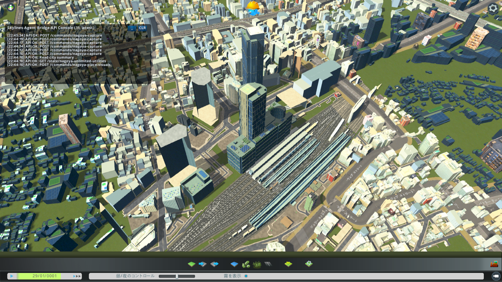
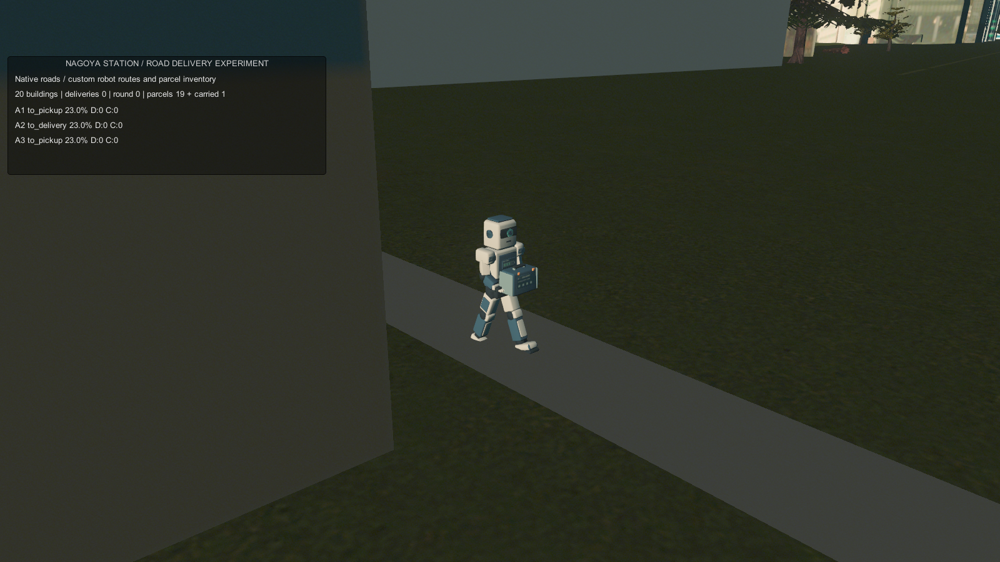
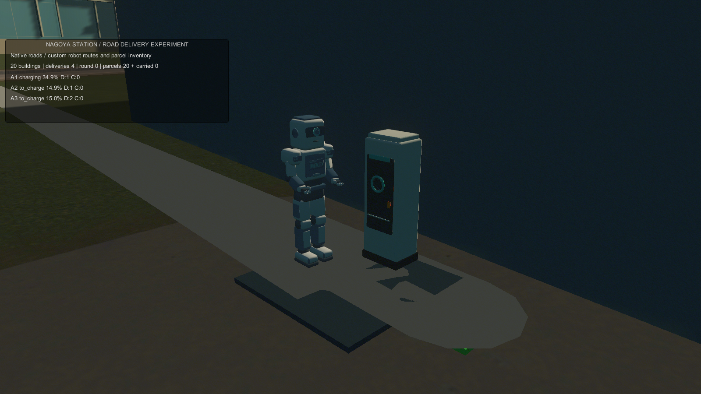
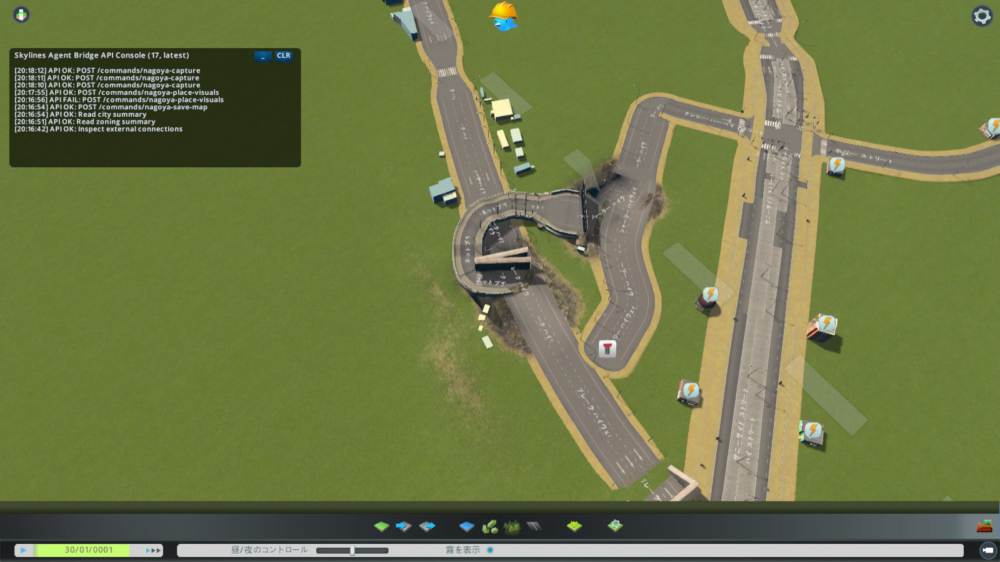
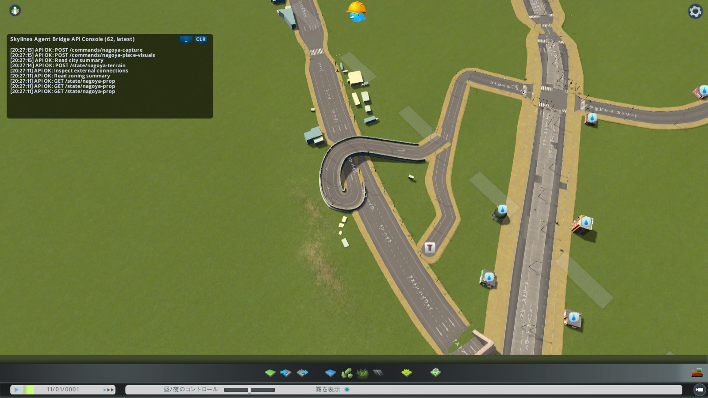
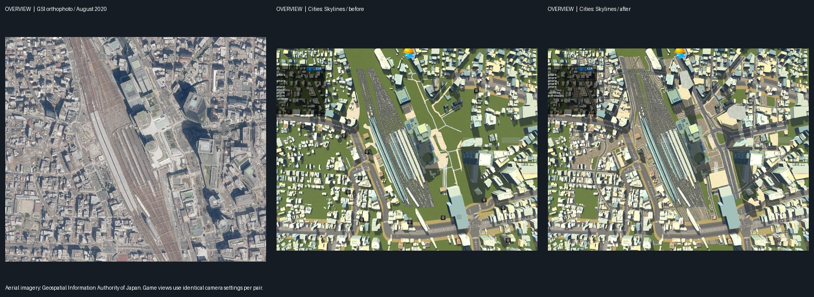

# Android Skyline — Nagoya 2050

English | [日本語](README.ja.md)

An experimental Cities: Skylines (2015) mod for studying how Android residents, deliveries, charging, zoning, and the native city economy can coexist in a Nagoya-scale test city. The repository contains the C# source, offline checks, and the written evidence from earlier runs.

This is a research-oriented source repository, not a one-click map pack. The required game save, external Nagoya data, PLATEAU/OSM-derived datasets, meshes, and some runtime assets are not included. An optional real-terrain bridge source may be present, but it still needs external data and the other loaders used by the map workflow.

## 🖼️ See the development

<a href="docs/images/ee713d36c24d5c3fbcb6a4ce.png"></a>

*Nagoya Station in the real-terrain map: a historical in-game capture from November 20, 2026.*

[**Explore all 80 development images**](docs/gallery.md): the 16 wards, 10 Blender model checks, road repairs and before/after records for eight station blocks.

| Early delivery experiment | Early charging experiment |
| --- | --- |
| <a href="docs/images/8eec27c6ccd82a3d77967fe2.png"></a> | <a href="docs/images/1c2f841f666ebe544bde4c31.png"></a> |

| Road before repair | Road after repair |
| --- | --- |
| <a href="docs/images/e949bc9f8ecf30e35955b76f.png"></a> | <a href="docs/images/490141b72fde292674399732.png"></a> |

<a href="docs/images/416b68f8d50d971bc928321c.jpg"></a>

*Left to right: GSI aerial imagery from August 2020, the game before, and the game after. The life-simulation trials and real-terrain map are separate stages.*

## 🧭 Start here

- [Documentation home](docs/index.md)
- [Getting started](docs/getting-started.md) — prerequisites, build, offline test, and live-check commands
- [Architecture](docs/architecture.md) — native CS1 systems versus independent MOD-owned simulation
- [Data and licenses](docs/data-and-licenses.md) — what is included, what is external, and attribution boundaries
- [Troubleshooting](docs/troubleshooting.md)
- [Contributing](CONTRIBUTING.md)
- [Security policy](SECURITY.md)

The longer Japanese experiment notes remain available as source evidence:

- [Native economy experiment](docs/native-economy.md)
- [Android life and employment trials](docs/android-life.md)
- [Citywide zoning and native construction](docs/citywide-zoning.md)
- [Native construction notes](docs/native-city-construction.md)
- [Real-terrain road/building QA](docs/real-terrain-road-building-qa.md)
- [Optional real-terrain source](docs/real-terrain-source.md)
- [Nagoya Station aerial comparison](docs/nagoya-station-aerial-comparison.md)
- [Nagoya Station block-by-block record](docs/nagoya-station-block-by-block.md)

## 🧪 What this repository demonstrates

The current codebase contains three related but distinct paths:

1. **Native CS1 construction and economy hooks.** In cities whose name starts with `NagoyaCitywide-`, the `NativeCity*` components use CS1 roads, zoning, buildings, residents, workplaces, utilities, and save-backed ledgers. PLATEAU IDs are treated as source identities for placement/audit; the source mesh itself is not a native economic building.
2. **A route-owned citywide experiment.** `CitywideScene` and `CitywideSimulation` load an external routing graph and draw Androids, humans, roads, parcels, and chargers. This path owns its actor and parcel rules; it is not the same thing as native citizen pathfinding or native demand.
3. **A small waypoint demo and district pilots.** `AndroidDemo` is a deliberately simple in-game delivery/charging loop. Its own state identifies it as waypoint logic, not citizen pathfinding. The district controllers and historic life trials are useful experiments, not proof that every path is native.

Keep those paths separate when reading results. A shared map or screenshot does not by itself mean that a MOD-owned actor used a native citizen route, that a PLATEAU mesh became a native lot, or that an Android delivery changed native demand.

## 📏 Repository facts

At the source revision documented here:

- `src/` contains **52 C# files**; `build.ps1` discovers and compiles every `src/*.cs` file.
- `tests/` contains three C# checks, including the runtime-path check, offline fleet simulation, and native-city ledger round trip.
- `tools/` contains data planners, auditors, capture helpers, and the live-state verifier. They consume external datasets and game state; they do not ship those inputs.
- The repository's recorded trials are historical observations tied to named saves and external runtime data. They are not a reproducible benchmark package.

## 🛠️ Build and test

Build on Windows with a compatible Cities: Skylines 1 installation, its `Cities_Data/Managed` assemblies, a compatible CitiesHarmony DLL, and the .NET Framework 3.5 C# compiler:

```powershell
$game = 'G:\SteamLibrary\steamapps\common\Cities_Skylines'
$data = 'H:\CS1-PLATEAU\nagoya-station'
./build.ps1 -ManagedDirectory "$game\Cities_Data\Managed" `
    -HarmonyAssembly "$data\runtime\lib\CitiesHarmonyOfficial\CitiesHarmony\CitiesHarmony.Harmony.dll"
```

The output is `.build/NagoyaAndroidDemo.dll`. Copy it manually, after backing up any existing build and while the game is closed, to:
`%LOCALAPPDATA%\Colossal Order\Cities_Skylines\Addons\Mods\NagoyaAndroidDemo\`.
Enable CitiesHarmony and the MOD in the game. This repository does not contain a compatible save or the external data needed to make a complete Nagoya map appear.

Run the offline check with the repository's synthetic fixture:

```powershell
./test.ps1
```

Validate the configured/default data roots without launching the game:

```powershell
./test-paths.ps1
```

To check a real production dataset, pass its inputs explicitly instead of relying on a local default:

```powershell
$service = 'H:\CS1-PLATEAU\nagoya-station\citywide-live-v1\building-service-v1'
./test.ps1 -GraphPath "$service\routing.ncg" -RegionsPath "$service\regions.json"
```

For the live verifier, inspect the available options first:

```powershell
uv run --python 3.11 tools/verify_live.py --help
```

The live check requires a running game/bridge state and a fresh `citywide-live-v1/state.json`; it is not a substitute for the offline test.

## 🗂️ Runtime data roots

The MOD reads data outside this repository. The source supports these process-start configuration variables:

| Variable | Meaning | Default when unset |
| --- | --- | --- |
| `NAGOYA_DATA_ROOT` | Absolute path to the external `nagoya-station` data root | `H:\CS1-PLATEAU\nagoya-station` |
| `NAGOYA_ANDROID_DEMO_ROOT` | Absolute path to the separate legacy waypoint-demo root | `H:\CS1-PLATEAU\android` |

Paths are resolved once when the game process starts. Restart the game after changing either variable. Runtime subdirectories include `citywide-live-v1`, `citywide-zoning-v3`, `simulation`, and asset manifests; their contents are intentionally not vendored here.

## ⚠️ Scope and limitations

- No external saves, map packages, large terrain/building datasets, or mesh catalog are shipped. Optional bridge source does not make the map workflow self-contained.
- The real-terrain and station records describe a separate map-building/launcher workflow. They are retained as historical evidence and are not a promise that this DLL can install that map by itself.
- Historical life-simulation results are evidence from prior runs, not a guarantee of current performance or a release benchmark. Re-run the checks against the exact save and data revision you intend to study.
- Cities: Skylines and CitiesHarmony are third-party software. This project is not affiliated with or endorsed by Paradox Interactive, Colossal Order, or the data providers.

## 📜 License

Repository code is released under the [MIT License](LICENSE). Third-party game files, PLATEAU/OSM/GSI-derived data, photographs, meshes, and saves remain subject to their own terms; see [Data and licenses](docs/data-and-licenses.md).

## 🤝 Contributing

Please read [CONTRIBUTING.md](CONTRIBUTING.md) before opening an issue or pull request. For a security concern, follow [SECURITY.md](SECURITY.md).
