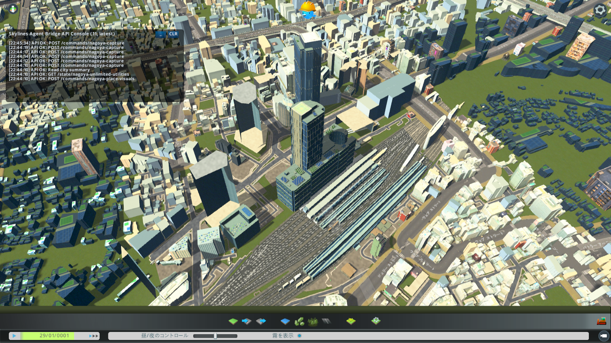

# Nagoya Android Economy documentation

This documentation describes an experimental Cities: Skylines (2015) mod and the evidence around it. It separates the source-level build from the external saves, datasets, and game-side tools required for a full Nagoya run.

## 開発を画像で追う / Visual development



[80枚の開発スクショを見る / Explore the 80-image gallery](gallery.md) · [16区](gallery.md#wards) · [道路修正](gallery.md#roads) · [8街区の前後比較](gallery.md#blocks)

撮影時点は各画像に記載。実機、初期実験、Blenderモデルを区別しています。

## Choose a path

| If you want to… | Read |
| --- | --- |
| Build the DLL or run an offline check | [Getting started](getting-started.md) |
| Understand native CS1 versus MOD-owned simulation | [Architecture](architecture.md) |
| Know what is bundled and what may be redistributed | [Data and licenses](data-and-licenses.md) |
| Diagnose a build, path, or live-check failure | [Troubleshooting](troubleshooting.md) |
| Maintain the repository and propose changes | [Contributing](https://github.com/Sunwood-ai-labs/nagoya-android-economy-cs1-mod/blob/main/CONTRIBUTING.md) |

## Evidence and historical experiments

The following pages record earlier runs. They are evidence tied to named saves and external runtime data, not a packaged benchmark or an installation promise.

- [Native economy experiment](native-economy.md)
- [Android life and employment](android-life.md)
- [Citywide zoning](citywide-zoning.md)
- [Native city construction](native-city-construction.md)
- [PLATEAU zoning pilot](plateau-zoning.md)

## Real-terrain map records

The real-terrain and Nagoya Station pages document a separate map-building and launcher/bridge workflow. An optional bridge source may be maintained separately, but visual meshes, large external datasets, and other loaders are not part of a self-contained map package. These pages do not imply one-click installation.

- [Real-terrain road/building QA](real-terrain-road-building-qa.md)
- [Optional real-terrain source](real-terrain-source.md)
- [Nagoya Station aerial comparison](nagoya-station-aerial-comparison.md)
- [Nagoya Station block-by-block record](nagoya-station-block-by-block.md)
- [Evidence index](evidence/index.md)

## Source layout

```text
src/       C# MOD and simulation components
tests/     Offline C# checks
tools/     Data planners, auditors, and live-state helpers
docs/      Guides, experiment notes, and evidence manifests
build.ps1  Compile every src/*.cs file into .build/NagoyaAndroidDemo.dll
test.ps1   Run the offline fleet check (synthetic fixture by default)
```

At the documented source state, `src/` contains 52 C# files. Runtime data, saves, map packages, and the large inputs/other loaders for the map workflow remain external; an optional bridge source is documented separately when present.

## Verification vocabulary

- **Offline check:** deterministic code-level checks over a synthetic or explicitly supplied routing dataset.
- **Live check:** a read-back from a running game and its generated state files; it requires the exact external data and save.
- **Historical evidence:** a record from a prior named save/run. It should not be read as a current release or performance guarantee.
- **Visual map record:** a real-terrain or station comparison produced by an external workflow; it is not proof that the DLL alone installs that map.
